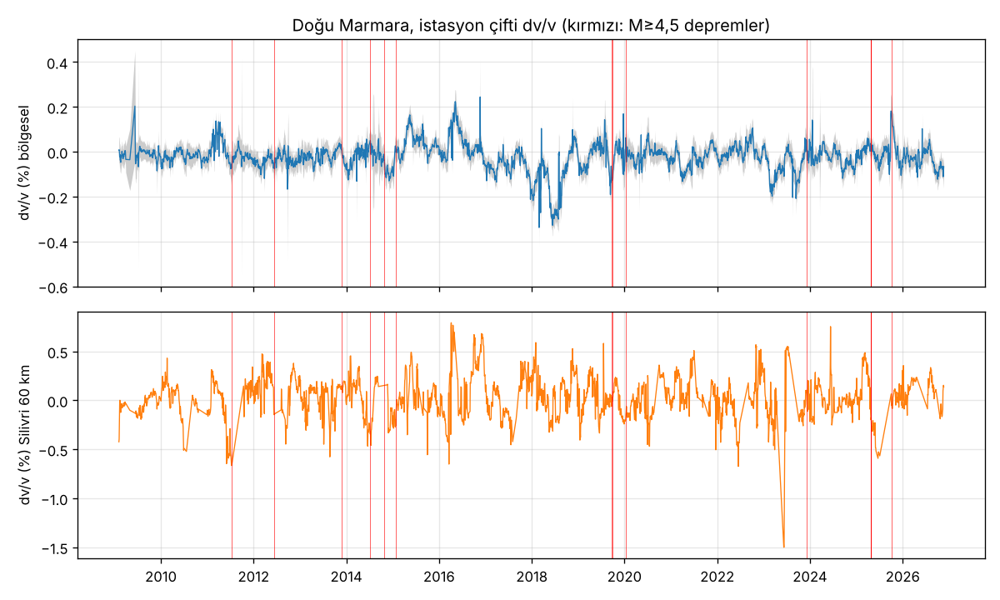

# Sismik hız değişimi (dv/v), istasyon çifti yöntemi: Doğu Marmara pilotu

> Deneysel araştırma çıktısıdır, deprem tahmini değildir.

## Kısa sonuç

* **Ölçüm çok daha iyi oldu.** Güvenilir ölçüm oranı %11'den %62'ye çıktı. Bölgesel serinin
  gerçek gürültüsü %0,2-0,7'den yaklaşık %0,05'e indi, yani 4-14 kat daha az. (İlk ara notta
  "~10 kat" demiştim; doğru aralık budur.)
* **Ölçüm gerçek bir şeyi görüyor.** 23 Nisan 2025 Silivri açığı M6,2 depreminden sonra yakındaki
  çiftlerde hız %0,85 düştü. Bu, olağan 90 günlük oynamanın 2,7 katı ve beklenen yönde. 2019 M5,7
  depreminde ise ölçülebilir bir düşüş yok. Yıllık mevsim döngüsü de ayırt edilemedi (%0,009 ± 0,007).
* **Depremden önce sinyal bulunamadı.** Depremlerden önceki dv/v değişimi rastgele günlerden
  farklı değil. M≥4 için olay sayısı (27) güçlü bir hüküm için de az.
* **Modele katkı sıfır.** dv/v eklenen model, dv/v'siz taban modelle aynı puanı aldı. Bu hem Türkiye
  genelinde hem de pilot bölgedeki depremlerde böyle; fark sıfırdan ayırt edilemiyor.

Özellik modelde "pilot" olarak kalabilir; eğitilen etki her yıl sıfıra yakın olduğundan tahminleri
fiilen değiştirmez.

## Ne yapıldı

* **Veri:** KOERI KO ağının 12 istasyonu (Doğu Marmara: ADVT, ARMT, YLV, HRTX, MDNY, CAVI, SILT,
  BGKT, KLYT, ISK, GULT, EDC), 66 istasyon çifti. 2009-2026, iki günde bir 4 saatlik sürekli
  kayıt (20-24 UT, gece gürültüsü düşük). Toplam 3267 gün indirildi.
* **İşlem:** 0,1-1 Hz bandı, 30 dakikalık pencereler, tek-bit normalleştirme ve spektral beyazlatma,
  çift başına çapraz korelasyon (±180 s). Her ölçüm yalnız **geçmiş** 60 günün yığınından yapılır
  (geleceğe bakmaz). Hız değişimi germe (stretching) yöntemiyle, belirsizlik Weaver vd. (2011) ile.
  Referans her çiftin ilk iki yılıdır. Bölgesel seri, çiftlerin ters-varyans ağırlıklı ortalamasıdır.
* **Ayarlar depremlere bakılmadan seçildi:** kod penceresi ve yığın uzunluğu yalnız 2009-2011
  verisinde, çiftleri ikiye bölerek ölçülen gürültüye göre sabitlendi.
* **Modele giden özellik:** hücre başına "son 6 ay − önceki 2 yıl" dv/v farkı. İstasyon çiftlerinin
  orta noktalarından 40 km yarıçaplı ağırlıkla 0,5°'lik hücrelere dağıtıldı.
* **Karşılaştırma:** aynı katalog, aynı ETAS ve aynı 11 katalog örneği (en iyi tahmin ve 10 kaydırılmış
  örnek) ile iki koşu yapıldı: dv/v'siz (`turkey_v5_base`) ve dv/v'li (`turkey_v5_dvvpairs`).
  Puanlama M≥4 depremlerle, 1995-2025 arasında deprem deprem ileri yürüyerek yapıldı.



## 1. Ölçüm kalitesi

| | önceki (tek istasyon, PR #9) | bu çalışma (istasyon çifti) |
|---|---|---|
| güvenilir ölçüm oranı (benzerlik > 0,5) | %11 | %62 |
| tek ölçüm belirsizliği (ortanca) | %0,2-0,7 | %0,145 |
| bölgesel seri gürültüsü (çiftler ikiye bölünerek) | — | %0,054 |
| ölçüm (çift × zaman) | 5348 | 145 516 |

Weaver formülünden çıkan bölgesel belirsizlik (%0,022) iyimserdir. Gerçek gürültü, çiftleri iki
yarıya bölüp iki ortalamanın farkından ölçüldü: %0,054.

## 2. Doğrulama: ölçüm bilinen olayları görüyor mu?

| sınama | sonuç | yorum |
|---|---|---|
| 2025-04-23 M6,2 Silivri açığı (60 km içinde 2 çift) | sonrası − öncesi **−%0,85**; olağan 90 günlük oynama %0,31; z = −2,7 | beklenen yönde ve belirgin düşüş |
| 2019-09-26 M5,7 Silivri (60 km içinde 2 çift) | −%0,15; z = −0,5 | ayırt edilemiyor |
| yıllık mevsim döngüsü (bölgesel) | %0,009 ± 0,007 genlik | ayırt edilemiyor |

Yalnız büyük (M6) bir depremin etkisini görebiliyoruz. Bu yöntemin bilinen davranışıyla uyumlu:
dv/v en net olarak depremden **sonra** düşer.

## 3. Deprem öncesi sinyal var mı?

Pilot kutudaki her bağımsız depremin (artçılar ayıklandı) öncesindeki dv/v değişimine bakıldı.
Değişim, rastgele seçilmiş haftalık günlerin en düşük %10'una giriyorsa "alarm" sayıldı. Sinyal
yoksa depremlerin %10'u alarm içinde düşer.

| eşik | ölçek | olay | alarm içinde | %95 GA | olasılık kazancı |
|---|---|---|---|---|---|
| M≥3 | kısa (son 60 gün − önceki 180 gün) | 115 | %8,7 | 4,3-13,9 | 0,87 |
| M≥3 | yıllık (6 ay − önceki 2 yıl) | 128 | %7,8 | 3,9-12,5 | 0,78 |
| M≥4 | kısa | 27 | %18,5 | 3,7-33,3 | 1,85 |
| M≥4 | yıllık | 27 | %0 | 0-0 | 0 |

Hiçbiri rastgele beklentiden (%10) ayırt edilemiyor. M≥4 kısa ölçekteki 1,85, 27 olayda 5 olay
demektir; aralığı %10'u rahatça içeriyor ve aynı olaylar yıllık ölçekte hiç alarm vermiyor.

## 4. Modele katkı

Olay başına bilgi kazancı farkı (dv/v'li − dv/v'siz, nat). Pozitif değer dv/v'nin yardım ettiği anlamına gelir.

| kapsam | olay (örnek başına) | fark | %95 GA | zaman payı | konum payı |
|---|---|---|---|---|---|
| Türkiye geneli 1995-2025 | 4293 | −0,0002 | [−0,0008, 0,0004] | 0,0001 | −0,0003 |
| Türkiye geneli 2012-2025 | 2562 | −0,0003 | [−0,0013, 0,0007] | 0,0002 | −0,0005 |
| Doğu Marmara pilot kutusu 2012-2025 | 47 | −0,016 | [−0,070, 0,019] | 0,004 | −0,019 |

Modelin dv/v'ye verdiği ağırlık 2012-2026 arasında her yıl −0,05 ile −0,14 arasında kaldı.
Belirsizliği ise 0,10-0,15 civarında, yani etki hiçbir yıl sıfırdan ayırt edilemedi.

## Sınırlar

* Pilot yalnız Doğu Marmara'yı kapsıyor ve bölgede 2012 sonrası M≥4 bağımsız deprem az (27).
  Burada küçük bir öncü etki kaçmış olabilir; ancak var olsa bile bu veriyle görülemeyecek kadar küçük.
* Silivri'ye 60 km içinde yalnız 2 çift var; yerel seriler gürültülü (%0,3).
* Günde 4 saat kullanıldı. 24 saatin tamamı gürültüyü yaklaşık yarıya indirebilir, ama indirme
  süresi 6 katına çıkar (bu pilot ~10 saat sürdü).

## Yeniden üretmek

```bash
python scripts/fetch_dvv_pairs.py ccf                      # indirme ve korelasyon (~10 saat, kaldığı yerden sürer)
python scripts/fetch_dvv_pairs.py dvv --stack-days 60      # dv/v serileri (~5 dk)
python scripts/eval_dvv_pairs.py                           # kalite, doğrulama, öncül sınaması, şekil
python scripts/train_long.py --config configs/train_dvv_base.toml
python scripts/train_long.py --config configs/train_dvv_pairs.toml
python scripts/compare_dvv_pairs.py                        # iki modelin karşılaştırması
```
