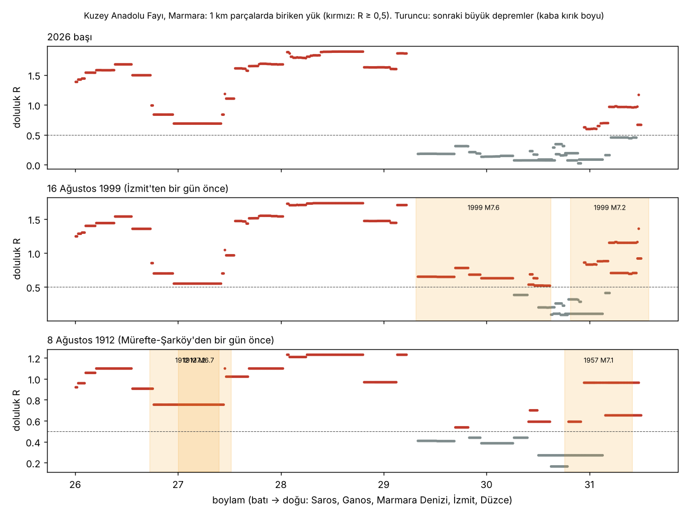

# Fay fay biriken enerji, küçük depremler ve komşu fay zinciri

> Deneysel araştırma çıktısıdır, deprem tahmini değildir. Hiçbir gösterge kanıtsız doğrulanmış sayılmaz.

## Kısa özet (sade dille)

- **Küçük depremler fayı boşaltmıyor.** Faylara düşen toplam deprem momentinin yalnız binde 6'sı M<5,5 depremlerden geliyor. Biriken yük büyük depremlere kalıyor.
- **Fay fay biriken yük hesaplandı** (segment segment ve 1 km parça parça). Tablolar ve Marmara profili aşağıda. Bu sayılar 1700'de sıfırdan başlayan bir saatle ve tek bir kaya dayanımı varsayımıyla hesaplandı; kesin değil, göreli.
- **Bu göstergeler, depremin ne zaman ve nerede olacağını tahmin etmeye şimdilik katkı vermedi.** Moment açığı, küçük/büyük deprem oranı (b-değeri), yüklü komşu fay zinciri ve 1 km parçalar; hiçbiri ana modeli ya da ETAS'ı anlamlı biçimde geçmedi. Karıştırma testi de gerçek katkıyı şanstan ayıramadı.
- **"Biri sınırdaysa yeter mi, boydan boya mı yüklü olmalı?"** Bu veriyle ayırt edilemedi: ne tek segmentin ne de yüklü komşu zincirinin uzunluğu, gelen depremin büyük (M≥6,5) olup olmayacağını sabit orandan daha iyi söyledi.
- **Marmara:** 1 km hesabında Marmara Denizi altındaki ana fay 18. yüzyıldan beri büyük bir boşalım yaşamamış, yük biriktiriyor görünüyor (bilimsel literatürdeki 'İstanbul sismik boşluğu' ile uyumlu); 1999 öncesinde de İzmit kırığı bölgesi yüklü görünüyordu. Ancak bu tek tek örnekler kanıt sayılmaz: Marmara'daki 44 depremle yapılan sınamada göstergeler modele katkı vermedi.
- **Sonuç:** Hipotez çürütülmedi ama desteklenmedi de. Asıl engel, fayların 1700'deki yükünü ve geçmiş büyük kırıkların gerçek uzunluklarını bilmemek.

## 1. Küçük depremler fayı boşaltıyor mu?

1700'den 2025 sonuna kadar fay segmentlerine düşen toplam deprem momentinin yalnız **%0.60**'i M<5,5 depremlerden geliyor. Kayıtlı bütün küçük depremler (432,386 deprem) toplamda, Türkiye faylarının yalnız ≈1.3 yılda biriktirdiği yükü boşaltmış. Yani küçük depremler fayı boşaltmıyor, yük büyük depremlere kalıyor. Küçük depremler enerjiyi değil, gerilmenin nasıl değiştiğine dair ipucunu (b-değeri) taşıyabilir. (Küçük depremlerin kaydı 1998'den önce eksik; eksik olanlar eklense de bu oran birkaç kattan fazla değişmez, çünkü her büyüklük basamağı bir öncekinin ~30 katı enerji taşır.)

## 2. Fay fay biriken yük (2026 başı)

Doluluk R = biriken moment açığı / fayın kaldırabileceği (10 MPa gerilme düşümüyle). Saat 1700'de sıfırdan başlıyor; 1700'den beri kırılmamış faylarda gerçek değer daha yüksek olabilir. R kalibre edilmemiş, göreli bir ölçüdür: R = 1, fayın taşıyabileceği en büyük gerilme düşümüne denk yük demektir, fayın o an kırılacağı anlamına gelmez. Kayma hızı ≥ 2 mm/yıl, uzunluk ≥ 10 km segmentler, en dolu 20. Tamamı: `reports/tables/fault_energy_2026.csv`.

| segment    | sistem                  |   uzunluk_km |   kayma_hızı_mm_yıl |   doluluk_R |   açık_Mw_eşdeğeri |   enerji_PJ |   yüklü_zincir_km |   zincirin_olası_Mw |   b_farkı_z |
|:-----------|:------------------------|-------------:|--------------------:|------------:|-------------------:|------------:|------------------:|--------------------:|------------:|
| ME_TRCS003 | Kuzey Anadolu Fayı      |          301 |                22.4 |        1.9  |               7.88 |        41.1 |               301 |                 8.3 |       -3.04 |
| ME_TRCS006 | Kuzey Anadolu Fayı      |          301 |                25   |        1.86 |               8    |        63.2 |               301 |                 8.3 |        0.03 |
| ME_TRCS013 | Kuzey Anadolu Fayı      |          104 |                21.4 |        1.79 |               7.64 |        17.9 |               379 |                 8.5 |        1.2  |
| ME_TRCS996 | Kuzey Anadolu Fayı      |          275 |                21.9 |        1.36 |               7.92 |        47.4 |               379 |                 8.5 |       -1.55 |
| ME_TRCS396 | diğer: Batı Anadolu-Ege |           42 |                 5.5 |        1.25 |               6.26 |         0.2 |               124 |                 7.7 |       -3.3  |
| ME_TRCS001 | Kuzey Anadolu Fayı      |           52 |                13.5 |        0.98 |               7.22 |         4.2 |                52 |                 7   |       -0.49 |
| ME_TRCS393 | Ege graben sistemi      |           31 |                 9.8 |        0.95 |               7.02 |         2.1 |               124 |                 7.7 |       -2.81 |
| ME_TRCS010 | Kuzey Anadolu Fayı      |           47 |                19.3 |        0.91 |               7.29 |         5.4 |                47 |                 7   |       -2.33 |
| ME_TRCS391 | Ege graben sistemi      |           51 |                 9   |        0.78 |               7.03 |         2.2 |               124 |                 7.7 |       -3.95 |
| ME_TRCS269 | Ege graben sistemi      |           27 |                 7.9 |        0.76 |               6.94 |         1.6 |                64 |                 7.2 |       -1.67 |
| ME_TRCS273 | Ege graben sistemi      |           25 |                 7.4 |        0.72 |               6.9  |         1.4 |                25 |                 6.5 |       -3.06 |
| ME_TRCS274 | Ege graben sistemi      |           17 |                 7.3 |        0.71 |               6.79 |         1   |                17 |                 6.2 |       -3.23 |
| ME_TRCS268 | Ege graben sistemi      |           37 |                 7.4 |        0.7  |               7    |         2   |                64 |                 7.2 |       -3.6  |
| ME_TRCS049 | Doğu Anadolu Fayı       |           45 |                10   |        0.68 |               7.2  |         4   |                85 |                 7.4 |       -2.74 |
| ME_GRCS699 | diğer: Orta Anadolu     |          178 |                 6   |        0.65 |               7.38 |         7.4 |               178 |                 7.9 |        0    |
| ME_TRCS271 | Ege graben sistemi      |           40 |                 7.4 |        0.62 |               7.08 |         2.6 |                40 |                 6.9 |       -1.43 |
| ME_TRCS275 | Ege graben sistemi      |           29 |                 5.5 |        0.54 |               6.86 |         1.2 |                29 |                 6.6 |       -0.88 |
| ME_TRCS051 | Doğu Anadolu Fayı       |           41 |                10   |        0.52 |               7.09 |         2.7 |                85 |                 7.4 |       -3.32 |
| ME_TRCS046 | diğer: Güneydoğu        |           46 |                 8.1 |        0.51 |               7.06 |         2.5 |                46 |                 7   |       -0.91 |
| ME_TRCS008 | Kuzey Anadolu Fayı      |           32 |                12   |        0.47 |               6.94 |         1.6 |                 0 |               nan   |       -2.21 |

enerji_PJ: biriken elastik enerji (petajoule; 1 PJ ≈ 240 kiloton TNT), E ≈ 3 MPa/(2μ) × moment açığı. açık_Mw_eşdeğeri: biriken açığın tamamı tek depremde boşalsa büyüklüğü.

## 3. Büyük depremler (M≥6,5, 1900 sonrası): kırılmadan hemen önce fay ne durumdaydı?

Yüklü = R ≥ 0.5. Zincir: depremin düştüğü segmente uç uca bağlı (≤ 5 km) yüklü segmentlerin toplam boyu. Gerçek kırık boyu büyüklükten (Wells & Coppersmith 1994) kaba tahmin.

| tarih      |   Mw | segment     | sistem                  |   doluluk_R |   segment_boyu_km |   segmentin_tek_başına_Mw |   yüklü_zincir_km |   zincirin_olası_Mw |   gerçek_kırık_km (tahmini) |   b_farkı_z |   1km_doluluk |   1km_yüklü_boy_km |
|:-----------|-----:|:------------|:------------------------|------------:|------------------:|--------------------------:|------------------:|--------------------:|----------------------------:|------------:|--------------:|-------------------:|
| 1905-12-04 | 6.8  | ME_TRCS133  | diğer: Güneydoğu        |        0.04 |               186 |                       8   |                 0 |                     |                          37 |        0    |          0.27 |                  0 |
| 1910-06-25 | 6.51 | fay dışı    | nan                     |      nan    |               nan |                     nan   |               nan |               nan   |                         nan |      nan    |        nan    |                nan |
| 1912-08-09 | 7.23 | ME_TRCS996  | Kuzey Anadolu Fayı      |        0.94 |               275 |                       8.3 |               379 |                 8.5 |                          67 |        0    |          0.75 |                359 |
| 1912-09-13 | 6.72 | ME_TRCS996  | Kuzey Anadolu Fayı      |        0.82 |               275 |                       8.3 |               379 |                 8.5 |                          33 |        0    |          0.25 |                  0 |
| 1914-10-03 | 7.06 | ME_TRCS309  | Ege graben sistemi      |        0.25 |                61 |                       7.2 |                 0 |                     |                          53 |        0    |          0.25 |                  0 |
| 1916-01-24 | 7    | ME_TRCS003  | Kuzey Anadolu Fayı      |        1.51 |               301 |                       8.3 |               301 |                 8.3 |                          49 |        0    |          1.52 |                298 |
| 1919-11-18 | 7    | ME_TRCS210  | Ege graben sistemi      |        0.25 |                30 |                       6.6 |                 0 |                     |                          49 |        0    |          0.09 |                  0 |
| 1924-09-13 | 6.86 | ME_TRCS074  | diğer: Doğu             |        0.02 |               100 |                       7.5 |                 0 |                     |                          40 |        0    |          0.01 |                  0 |
| 1926-03-18 | 6.75 | ME_TRCS282  | diğer: Batı Anadolu-Ege |        0.07 |                42 |                       6.9 |                 0 |                     |                          35 |        0    |          0.04 |                  0 |
| 1926-06-26 | 6.97 | ME_GRCS965  | diğer: Batı Anadolu-Ege |        0.18 |                45 |                       6.9 |                 0 |                     |                          47 |        0    |          0.2  |                  0 |
| 1928-04-14 | 7.1  | EUR_BGCS004 | diğer: Batı Anadolu-Ege |        0.01 |                56 |                       7.1 |                 0 |                     |                          56 |        0    |          0.01 |                  0 |
| 1930-05-06 | 7.1  | ME_IRCS067  | diğer: Doğu             |        0.05 |                57 |                       7.1 |                 0 |                     |                          56 |        0    |          0.08 |                  0 |
| 1938-04-19 | 6.62 | ME_TRCS247  | diğer: Orta Anadolu     |        0.07 |               160 |                       7.9 |                 0 |                     |                          29 |        0    |          0.07 |                  0 |
| 1939-12-26 | 7.8  | ME_TRCS003  | Kuzey Anadolu Fayı      |        1.58 |               301 |                       8.3 |               301 |                 8.3 |                         145 |        0    |          0.13 |                  0 |
| 1942-12-20 | 7    | ME_TRCS006  | Kuzey Anadolu Fayı      |        1.52 |               301 |                       8.3 |               301 |                 8.3 |                          49 |        0    |          1.52 |                292 |
| 1943-11-26 | 7.5  | ME_TRCS379  | Kuzey Anadolu Fayı      |        0.12 |                55 |                       7.1 |                 0 |                     |                          97 |        0    |          0.09 |                  0 |
| 1944-02-01 | 7.6  | ME_TRCS377  | diğer: Orta Anadolu     |        0.15 |                27 |                       6.6 |                 0 |                     |                         111 |        0    |          0.15 |                  0 |
| 1944-10-06 | 6.74 | ME_TRCS033  | Ege graben sistemi      |        0.17 |               132 |                       7.7 |                 0 |                     |                          34 |        0    |          0.23 |                  0 |
| 1948-02-09 | 7.3  | ME_GRCS780  | diğer: Batı Anadolu-Ege |        0.05 |                64 |                       7.2 |                 0 |                     |                          74 |        0    |          0.17 |                  0 |
| 1949-07-23 | 7.16 | ME_GRCS880  | Ege graben sistemi      |        0.22 |                56 |                       7.1 |                 0 |                     |                          61 |        0    |          0.11 |                  0 |
| 1949-08-17 | 6.78 | ME_TRCS115  | diğer: Kuzeydoğu        |        0    |                78 |                       7.3 |                 0 |                     |                          36 |        0    |          0.99 |                 44 |
| 1951-08-13 | 6.96 | fay dışı    | nan                     |      nan    |               nan |                     nan   |               nan |               nan   |                         nan |      nan    |        nan    |                nan |
| 1953-03-18 | 7.3  | ME_TRCS023  | diğer: Batı Anadolu-Ege |        0.33 |                97 |                       7.5 |                 0 |                     |                          74 |        0    |          0.2  |                  0 |
| 1955-07-16 | 6.57 | ME_TRCS337  | Ege graben sistemi      |        0.12 |                56 |                       7.1 |                 0 |                     |                          27 |        0    |          0.07 |                  0 |
| 1956-07-09 | 7.7  | EUR_GRCS958 | Ege graben sistemi      |        0.04 |                45 |                       6.9 |                 0 |                     |                         127 |        0    |          0.05 |                  0 |
| 1957-04-24 | 7.1  | fay dışı    | nan                     |      nan    |               nan |                     nan   |               nan |               nan   |                         nan |      nan    |        nan    |                nan |
| 1957-04-25 | 7.3  | fay dışı    | nan                     |      nan    |               nan |                     nan   |               nan |               nan   |                         nan |      nan    |        nan    |                nan |
| 1957-05-26 | 7.09 | ME_TRCS010  | Kuzey Anadolu Fayı      |        1.16 |                47 |                       7   |               216 |                 8.1 |                          55 |        0    |          1.16 |                 53 |
| 1964-10-06 | 6.8  | ME_TRCS023  | diğer: Batı Anadolu-Ege |        0.32 |                97 |                       7.5 |                 0 |                     |                          37 |        0    |          0.01 |                  0 |
| 1966-08-19 | 6.8  | ME_TRCS081  | diğer: Doğu             |        0.12 |                78 |                       7.3 |                 0 |                     |                          37 |        0    |          0.1  |                  0 |
| 1967-07-22 | 7.29 | ME_TRCS012  | Kuzey Anadolu Fayı      |        0.5  |               137 |                       7.8 |                 0 |                     |                          73 |        0    |          0.1  |                  0 |
| 1969-03-28 | 6.8  | fay dışı    | nan                     |      nan    |               nan |                     nan   |               nan |               nan   |                         nan |      nan    |        nan    |                nan |
| 1970-03-28 | 7.23 | ME_TRCS311  | Ege graben sistemi      |        0.09 |               173 |                       7.9 |                 0 |                     |                          67 |        0    |          0.01 |                  0 |
| 1971-05-22 | 6.58 | ME_TRCS046  | diğer: Güneydoğu        |        0.44 |                46 |                       7   |                 0 |                     |                          28 |        0    |          0.57 |                 18 |
| 1975-03-27 | 6.7  | ME_TRCS996  | Kuzey Anadolu Fayı      |        1.11 |               275 |                       8.3 |               379 |                 8.5 |                          33 |        0    |          0    |                  0 |
| 1975-09-06 | 6.7  | fay dışı    | nan                     |      nan    |               nan |                     nan   |               nan |               nan   |                         nan |      nan    |        nan    |                nan |
| 1976-11-24 | 7.3  | ME_IR149s1  | diğer: Doğu             |        0.08 |               101 |                       7.5 |                 0 |                     |                          74 |        0    |          0.14 |                  0 |
| 1983-10-30 | 6.8  | ME_TRCS113  | diğer: Doğu             |        0.09 |                78 |                       7.3 |                 0 |                     |                          37 |        0    |          0.03 |                  0 |
| 1988-12-07 | 6.8  | ME_AM2s2    | diğer: Doğu             |        0.06 |                77 |                       7.3 |                 0 |                     |                          37 |        0    |          0.06 |                  0 |
| 1991-04-29 | 7    | ME_G9s1s1   | diğer: Doğu             |        0.07 |               154 |                       7.8 |                 0 |                     |                          49 |        0    |          0.03 |                  0 |
| 1992-03-13 | 6.7  | ME_TRCS003  | Kuzey Anadolu Fayı      |        1.68 |               301 |                       8.3 |               301 |                 8.3 |                          33 |        0    |          1.11 |                298 |
| 1999-08-17 | 7.6  | ME_TRCS012  | Kuzey Anadolu Fayı      |        0.45 |               137 |                       7.8 |                 0 |                     |                         111 |        0    |          0.63 |                 80 |
| 1999-11-12 | 7.2  | ME_TRCS010  | Kuzey Anadolu Fayı      |        1.07 |                47 |                       7   |                79 |                 7.4 |                          64 |        0    |          1.15 |                 42 |
| 2002-02-03 | 6.5  | ME_TRCS204  | diğer: Orta Anadolu     |        0    |                33 |                       6.7 |                 0 |                     |                          25 |        0    |          0.01 |                  0 |
| 2011-10-23 | 7.1  | ME_TRCS423  | diğer: Doğu             |        0.02 |                27 |                       6.6 |                 0 |                     |                          56 |       -0.75 |          0.02 |                  0 |
| 2017-07-20 | 6.6  | ME_GRCS965  | diğer: Batı Anadolu-Ege |        0.07 |                45 |                       6.9 |                 0 |                     |                          28 |       -3.85 |          0.16 |                  0 |
| 2020-01-24 | 6.8  | ME_TRCS133  | diğer: Güneydoğu        |        0.07 |               186 |                       8   |                 0 |                     |                          37 |        1.01 |          0.54 |                 69 |
| 2020-10-30 | 7    | ME_GRCS915  | Ege graben sistemi      |        0.12 |                33 |                       6.7 |                 0 |                     |                          49 |       -2.29 |          0.04 |                  0 |
| 2023-02-06 | 7.8  | fay dışı    | nan                     |      nan    |               nan |                     nan   |               nan |               nan   |                         nan |      nan    |        nan    |                nan |
| 2023-02-06 | 6.7  | ME_TRCS056  | Doğu Anadolu Fayı       |        0    |               110 |                       7.6 |                 0 |                     |                          33 |        1.5  |          0    |                  0 |
| 2023-02-06 | 7.5  | fay dışı    | nan                     |      nan    |               nan |                     nan   |               nan |               nan   |                         nan |      nan    |        nan    |                nan |

43 fay üstü büyük depremin 10'inde depremin başladığı segment yüklüydü. 1 km parçalarla bakıldığında (merkez üssüne en yakın parça, 25 km içinde) 43 depremin 10'inde parça yüklüydü. Büyük depremlerin çoğu, bu hesapla 'boş' görünen yavaş faylarda oldu: bu faylarda deprem tekrarı binlerce yıl, saatimiz ise 1700'de başlıyor; fayın 1700'deki yükünü bilmiyoruz.

## 4. "Biri sınırdaysa yeter mi, yoksa boydan boya yüklü olmalı mı?" sınaması

Fay üstündeki her M≥5,5 deprem için (1900-2025, ilk 60'ı yalnız eğitim, 297 deprem puanlandı, 34'i M≥6,5): yalnız önceki depremlerle eğitilmiş bir model "bu deprem M≥6,5 olacak mı" olasılığı veriyor. Karşılaştırma: büyüklüğü hiç bilmeyen sabit oran (Gutenberg-Richter). Pozitif = o bilgi büyük depremleri ayırt etmeye yardım ediyor.

| bilgi                                 |   olay başına kazanç | %95 GA           |   p |   M≥6,5 olaylarda |   Holm p |
|:--------------------------------------|---------------------:|:-----------------|----:|------------------:|---------:|
| segment boyu (yükten bağımsız)        |               -0     | [-0.004, +0.003] |   1 |            -0.035 |        1 |
| yalnız kendi segmenti (yüklüyse boyu) |               -0.002 | [-0.005, +0.002] |   1 |            -0.046 |        1 |
| yüklü komşu zinciri                   |               -0.002 | [-0.006, +0.002] |   1 |            -0.047 |        1 |
| zincir + kendi doluluğu               |               -0.003 | [-0.010, +0.007] |   1 |            -0.046 |        1 |
| 1 km parçalarla yüklü kesintisiz boy  |               -0.001 | [-0.005, +0.004] |   1 |            -0.038 |        1 |

## 5. Göstergeler deprem modeline eklenince (ne zaman ve nerede)

Her deprem, yalnız önceki verilerle yeniden eğitilmiş modelle puanlandı (421 deprem 1900-2025; 97'i 2000-2025). Olay başına log olasılık farkı; GA yıl blokları bootstrap'ı; Holm düzeltmesi tablodaki tüm karşılaştırmalar için. b-değeri girdisi küçük deprem kaydı yeterli olan yıllarda (pratikte 1998 sonrası) doludur, öncesinde etkisizdir; bu yüzden 2000-2025 sütununa ayrıca bakın.

| model                                                  | karşı     |   1900-2025 | %95 GA           |     p |   1900-1959 |   1960-1999 |   2000-2025 |   M≥6,5 |   Holm p |
|:-------------------------------------------------------|:----------|------------:|:-----------------|------:|------------:|------------:|------------:|--------:|---------:|
| Ana model + moment açığı oranı (küçük depremler dahil) | ETAS      |      -0.011 | [-0.049, +0.022] | 1     |      -0.03  |       0.011 |       0.005 |  -0.052 |        1 |
| Ana model + moment açığı oranı (küçük depremler dahil) | ana model |       0     | [-0.002, +0.002] | 0.453 |      -0     |       0.002 |      -0.001 |   0     |        1 |
| Ana model + yerel b-değeri farkı (son 5 yıl)           | ETAS      |      -0.013 | [-0.051, +0.022] | 1     |      -0.03  |       0.01  |       0.001 |  -0.071 |        1 |
| Ana model + yerel b-değeri farkı (son 5 yıl)           | ana model |      -0.001 | [-0.015, +0.010] | 1     |       0     |       0     |      -0.005 |  -0.019 |        1 |
| Ana model + yüklü komşu fay zinciri uzunluğu           | ETAS      |      -0.011 | [-0.049, +0.024] | 1     |      -0.032 |       0.012 |       0.008 |  -0.051 |        1 |
| Ana model + yüklü komşu fay zinciri uzunluğu           | ana model |       0     | [-0.002, +0.002] | 0.511 |      -0.002 |       0.003 |       0.002 |   0.001 |        1 |
| Ana model + üçü birlikte                               | ETAS      |      -0.014 | [-0.052, +0.023] | 1     |      -0.034 |       0.011 |       0.001 |  -0.071 |        1 |
| Ana model + üçü birlikte                               | ana model |      -0.003 | [-0.017, +0.009] | 1     |      -0.004 |       0.002 |      -0.005 |  -0.019 |        1 |
| Ana model + moment açığı oranı, 1 km parçalarla        | ETAS      |      -0.01  | [-0.048, +0.024] | 1     |      -0.029 |       0.012 |       0.007 |  -0.05  |        1 |
| Ana model + moment açığı oranı, 1 km parçalarla        | ana model |       0.001 | [-0.002, +0.005] | 0.246 |       0.001 |       0.003 |       0.001 |   0.002 |        1 |
| Ana model + yüklü kesintisiz fay boyu, 1 km parçalarla | ETAS      |      -0.011 | [-0.050, +0.024] | 1     |      -0.032 |       0.01  |       0.011 |  -0.055 |        1 |
| Ana model + yüklü kesintisiz fay boyu, 1 km parçalarla | ana model |       0     | [-0.004, +0.004] | 0.464 |      -0.002 |       0     |       0.005 |  -0.003 |        1 |
| Ana model + üçü birlikte, 1 km parçalarla              | ETAS      |      -0.015 | [-0.055, +0.022] | 1     |      -0.036 |       0.011 |       0.003 |  -0.074 |        1 |
| Ana model + üçü birlikte, 1 km parçalarla              | ana model |      -0.003 | [-0.018, +0.009] | 1     |      -0.006 |       0.002 |      -0.003 |  -0.022 |        1 |

b-değeri, yalnız 2000-2025 (97 deprem), ana modele göre: -0.005 [-0.068, +0.045], p = 1.000 (düzeltmesiz).

Öğrenilen katsayılar (+ = gösterge yüksekken o fayda deprem daha olası). Girdiler: moment açığı log R; b farkı z; zincir log10(km/100).

| model                                      | girdi      |   katsayı (2025 sonu) |
|:-------------------------------------------|:-----------|----------------------:|
| moment açığı oranı (küçük depremler dahil) | deficit    |                -0.1   |
| yerel b-değeri farkı (son 5 yıl)           | bval       |                 0.183 |
| yüklü komşu fay zinciri uzunluğu           | chain      |                -0.197 |
| üçü birlikte                               | deficit    |                -0.029 |
| üçü birlikte                               | bval       |                 0.185 |
| üçü birlikte                               | chain      |                -0.173 |
| moment açığı oranı, 1 km parçalarla        | deficit_km |                -0.159 |
| yüklü kesintisiz fay boyu, 1 km parçalarla | chain_km   |                -0.266 |
| üçü birlikte, 1 km parçalarla              | deficit_km |                -0.076 |
| üçü birlikte, 1 km parçalarla              | bval       |                 0.184 |
| üçü birlikte, 1 km parçalarla              | chain_km   |                -0.192 |

### Fayı 1 km'lik parçalara bölmek, segment bütününe göre işe yarıyor mu?

Her fay 24,965 parçaya bölündü (1 km). Her parçada yük, kayma hızıyla her yıl artıyor; bir deprem o parçaya ulaştığında (merkezden kırık yarı boyu + 5 km) momenti kadar yük düşüyor, yük sıfırın altına inmiyor ("son kırılmadan beri biriken"). Pozitif = 1 km sürümü daha iyi.

| gösterge     |   1 km − segment (1900-2025) | %95 GA           |     p |   M≥6,5 |
|:-------------|-----------------------------:|:-----------------|------:|--------:|
| moment açığı |                        0.001 | [-0.000, +0.003] | 0.063 |   0.002 |
| yüklü zincir |                        0     | [-0.002, +0.002] | 0.455 |  -0.004 |
| üçü birlikte |                       -0.001 | [-0.003, +0.001] | 1     |  -0.002 |

### Şans kontrolü

Üç gösterge fay birimleri arasında rastgele karıştırıldı (her fay başka bir fayın göstergesini aldı; model her 20 depremde bir eğitildi). Gerçek katkı -0.008; 10 karıştırmada ortalama -0.003, en yüksek +0.001. Şans p = 0.91.

## 6. Marmara bölgesi

Marmara kutusunda (enlem 39.8-41.5, boylam 26.0-31.6) Kuzey Anadolu Fayı kuzey kolu 542 adet 1 km parçaya bölündü. 2026 başında bunların %59'i yüklü (R ≥ 0,5); en uzun kesintisiz yüklü parça 359 km. Tablo: `reports/tables/fault_energy_marmara_1km.csv`.

Marmara'daki segmentler (kayma hızı ≥ 2 mm/yıl), 2026 başı. Segment R tüm segmentin ortalaması; 1 km sütunları, segmentin depremlerle kısmen boşalmış parçalarını ayrı sayar.

| segment    | sistem                  |   orta boylam |   uzunluk_km |   kayma_hızı |   segment R |   1 km R ortalama |   1 km yüklü pay % |   b farkı z |   b olay sayısı |
|:-----------|:------------------------|--------------:|-------------:|-------------:|------------:|------------------:|-------------------:|------------:|----------------:|
| ME_TRCS996 | Kuzey Anadolu Fayı      |         26.58 |          275 |         21.9 |        1.36 |              1.39 |                100 |       -1.55 |             498 |
| ME_TRCS027 | diğer: Batı Anadolu-Ege |         26.65 |           98 |          3.6 |        0.25 |              0.26 |                  0 |       -4    |             240 |
| ME_TRCS417 | diğer: Batı Anadolu-Ege |         26.98 |           28 |          3   |        0.24 |              0.25 |                  0 |        0    |               0 |
| ME_TRCS031 | diğer: Batı Anadolu-Ege |         27.45 |           69 |          3.6 |        0.06 |              0.12 |                  0 |       -2.01 |             105 |
| ME_TRCS025 | diğer: Batı Anadolu-Ege |         27.48 |           44 |          3   |        0.06 |              0.06 |                  0 |       -2.38 |             153 |
| ME_TRCS024 | diğer: Batı Anadolu-Ege |         27.68 |           40 |          3   |        0.05 |              0.05 |                  0 |       -1.89 |             156 |
| ME_TRCS023 | diğer: Batı Anadolu-Ege |         28.49 |           97 |          5.3 |        0.38 |              0.38 |                  0 |       -1.45 |             289 |
| ME_TRCS013 | Kuzey Anadolu Fayı      |         28.63 |          104 |         21.4 |        1.79 |              1.79 |                100 |        1.2  |             594 |
| ME_TRCS040 | diğer: Batı Anadolu-Ege |         28.63 |           35 |          3.4 |        0.15 |              0.17 |                  0 |       -0.39 |             180 |
| ME_TRCS038 | diğer: Batı Anadolu-Ege |         29.06 |           26 |          5.3 |        0.25 |              0.25 |                  0 |       -0.51 |             226 |
| ME_TRCS039 | diğer: Batı Anadolu-Ege |         29.49 |           20 |          3.4 |        0.21 |              0.25 |                  0 |        0    |               0 |
| ME_TRCS028 | diğer: Batı Anadolu-Ege |         29.7  |           50 |          3.4 |        0.05 |              0.14 |                  0 |        0    |               0 |
| ME_TRCS022 | diğer: Batı Anadolu-Ege |         29.92 |          141 |          6.4 |        0.04 |              0.14 |                 12 |       -2.2  |             284 |
| ME_TRCS012 | Kuzey Anadolu Fayı      |         30.14 |          137 |         10.7 |        0.07 |              0.15 |                  0 |       -2.45 |             262 |
| ME_TRCS009 | Kuzey Anadolu Fayı      |         30.77 |           62 |         12.6 |        0.09 |              0.16 |                  0 |       -2.17 |             205 |
| ME_TRCS010 | Kuzey Anadolu Fayı      |         31.23 |           47 |         19.3 |        0.91 |              0.82 |                100 |       -2.33 |             315 |
| ME_TRCS008 | Kuzey Anadolu Fayı      |         31.32 |           32 |         12   |        0.47 |              0.44 |                 14 |       -2.21 |             273 |

Dikkat: katalog 1700'de başlıyor. Marmara'da 1509 ve daha önceki büyük depremler hesaba girmiyor; 1766 depremlerinin kırık uzunlukları tarihsel kaynaklarda tartışmalı, burada yalnız büyüklükten kaba tahmin edildi. Bu yüzden 1 km çözünürlük, yükün nerede biriktiğini değil, bu varsayımlarla nerede birikmiş görüneceğini gösterir.

Model sınaması yalnız Marmara depremleriyle (1900-2025, 44 deprem M≥5,5). Model tüm Türkiye verisiyle eğitildi, puan yalnız Marmara'daki depremlerden. Bu kadar az depremle küçük farklar şansla ayırt edilemez.

| model                                                  | karşı     |   Marmara 1900-2025 | %95 GA           |   p |   Holm p |
|:-------------------------------------------------------|:----------|--------------------:|:-----------------|----:|---------:|
| Ana model + moment açığı oranı (küçük depremler dahil) | ETAS      |              -0.094 | [-0.169, -0.011] |   1 |        1 |
| Ana model + moment açığı oranı (küçük depremler dahil) | ana model |              -0.005 | [-0.015, +0.004] |   1 |        1 |
| Ana model + yerel b-değeri farkı (son 5 yıl)           | ETAS      |              -0.102 | [-0.183, -0.013] |   1 |        1 |
| Ana model + yerel b-değeri farkı (son 5 yıl)           | ana model |              -0.013 | [-0.045, +0.000] |   1 |        1 |
| Ana model + yüklü komşu fay zinciri uzunluğu           | ETAS      |              -0.098 | [-0.177, -0.018] |   1 |        1 |
| Ana model + yüklü komşu fay zinciri uzunluğu           | ana model |              -0.009 | [-0.024, +0.002] |   1 |        1 |
| Ana model + üçü birlikte                               | ETAS      |              -0.114 | [-0.197, -0.027] |   1 |        1 |
| Ana model + üçü birlikte                               | ana model |              -0.025 | [-0.062, -0.003] |   1 |        1 |
| Ana model + moment açığı oranı, 1 km parçalarla        | ETAS      |              -0.097 | [-0.176, -0.014] |   1 |        1 |
| Ana model + moment açığı oranı, 1 km parçalarla        | ana model |              -0.009 | [-0.021, +0.002] |   1 |        1 |
| Ana model + yüklü kesintisiz fay boyu, 1 km parçalarla | ETAS      |              -0.102 | [-0.182, -0.017] |   1 |        1 |
| Ana model + yüklü kesintisiz fay boyu, 1 km parçalarla | ana model |              -0.013 | [-0.033, +0.004] |   1 |        1 |
| Ana model + üçü birlikte, 1 km parçalarla              | ETAS      |              -0.119 | [-0.205, -0.030] |   1 |        1 |
| Ana model + üçü birlikte, 1 km parçalarla              | ana model |              -0.031 | [-0.069, -0.004] |   1 |        1 |

## Yöntem ve sınırlar

- Yöntem: `src/deprem/fault_energy.py`; modele ekleme: `src/deprem/faultwalk.py` (`partial_*` sürümleri).
- Kayma hızları GEM aktif fay veritabanından (jeolojik ve jeodezik derlemesi); GPS kilitlenme oranı bu sürümde kullanılmadı, krip yapan faylarda yük olduğundan fazla görünür.
- Deprem momenti, merkez üssünden kırık yarı boyu + 5 km içindeki fay izlerine dağıtıldı; tek yönlü kırılan büyük depremlerde (ör. 1939, 2023) boşalımın bir kısmı yanlış segmente düşer.
- 1700-1899 kataloğu eksik; o dönemde boşalım az sayılır, doluluk olduğundan yüksek görünür.
- Kapasite tek bir gerilme düşümüyle (10 MPa) hesaplandı; gerçek değer fay fay 1-30 MPa arasında değişebilir. Gerilme düşümünü fay fay ölçmek için dalga biçimi spektrumları gerekir; bu sürümde yok.
- Yüklülük eşiği (R ≥ 0,5) ve b penceresi (5 yıl, 30 km, ≥ 50 olay) sonuçlara bakılmadan önceden seçildi.
