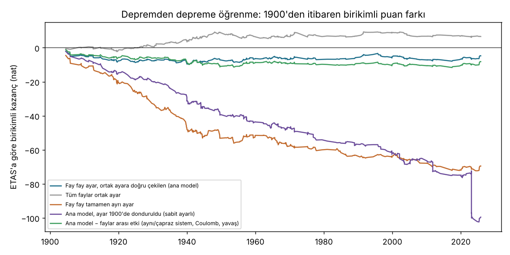

# Depremden depreme, fay fay öğrenen model

> Deneysel araştırma çıktısıdır, deprem tahmini değildir.

Katalog: 640 deprem (M≥5,5, Türkiye kutusu, 1700-2025; 1700-1899 tarihsel katalog, 1900 sonrası USGS/EMSC/AFAD birleşik).

Her deprem için model **yalnız o depremden önceki** depremlerle yeniden eğitildi, sonra o depremin ne zaman ve hangi 0,5° hücrede olacağına verdiği olasılıkla puanlandı. Puan farkı olay başına doğal log birimindedir: +0,10 ≈ gerçekleşen depremlere ETAS'tan %10 daha yüksek olasılık vermek.

## Sonuçlar (ETAS'a göre olay başına kazanç, aynı sıralı düzende)

1900-2025: 421 deprem. Güven aralığı yıl blokları bootstrap'ı, p değerleri Holm ile çoklu teste göre düzeltildi.

| model                                                              |   1900-2025 kazanç | %95 GA           |   p (tek yönlü) |   zaman |   konum |   1700-1899 (eksik katalog) |   1900-1959 |   1960-1999 |   2000-2025 |   M≥6,5 olaylar |   Holm p |
|:-------------------------------------------------------------------|-------------------:|:-----------------|----------------:|--------:|--------:|----------------------------:|------------:|------------:|------------:|----------------:|---------:|
| Yalnız uzun dönem harita (tetiklemesiz)                            |             -1.47  | [-1.979, -1.004] |           1     |  -0.575 |  -0.896 |                      -0.56  |      -1.023 |      -1.666 |      -2.236 |          -0.569 |        1 |
| Tüm faylar ortak ayar                                              |              0.016 | [-0.014, +0.044] |           0.135 |  -0.003 |   0.019 |                       0.002 |       0.03  |       0.022 |      -0.024 |           0.031 |        1 |
| Fay fay ayar, ortak ayara doğru çekilen (ana model)                |             -0.011 | [-0.047, +0.024] |           1     |  -0.002 |  -0.009 |                      -0.014 |      -0.03  |       0.009 |       0.006 |          -0.052 |        1 |
| Fay fay tamamen ayrı ayar                                          |             -0.165 | [-0.239, -0.096] |           1     |  -0.011 |  -0.154 |                      -0.359 |      -0.241 |      -0.111 |      -0.06  |          -0.211 |        1 |
| Ana model, ayar 1900'de donduruldu (sabit ayarlı)                  |             -0.236 | [-0.371, -0.134] |           1     |  -0.136 |  -0.1   |                      -0.014 |      -0.204 |      -0.166 |      -0.388 |          -0.308 |        1 |
| Ana model − faylar arası etki (aynı/çapraz sistem, Coulomb, yavaş) |             -0.019 | [-0.055, +0.014] |           1     |  -0.002 |  -0.018 |                      -0.008 |      -0.041 |      -0.011 |       0.017 |          -0.075 |        1 |
| Ana model − büyük faylar arası çapraz etki                         |             -0.007 | [-0.042, +0.024] |           1     |   0     |  -0.007 |                      -0.021 |      -0.026 |       0.013 |       0.01  |          -0.039 |        1 |
| Ana model − Coulomb gerilme yönü                                   |             -0.01  | [-0.048, +0.025] |           1     |  -0.002 |  -0.008 |                      -0.006 |      -0.028 |       0.01  |       0.008 |          -0.052 |        1 |
| Ana model − yavaş (yıllar-on yıllar) etki                          |             -0.026 | [-0.064, +0.010] |           1     |  -0.004 |  -0.022 |                      -0.01  |      -0.05  |      -0.012 |       0.012 |          -0.09  |        1 |
| Ana model, 100 km ötesi etki kesik                                 |             -0.095 | [-0.172, -0.029] |           1     |  -0.03  |  -0.064 |                      -0.033 |      -0.158 |      -0.004 |      -0.057 |          -0.122 |        1 |
| Ana model − fay doluluğu                                           |              0.002 | [-0.030, +0.034] |           0.456 |  -0.002 |   0.004 |                       0.018 |       0.004 |       0.009 |      -0.008 |          -0.018 |        1 |
| Ana model + Doğu Marmara dv/v                                      |             -0.011 | [-0.049, +0.023] |           1     |  -0.002 |  -0.009 |                      -0.014 |      -0.03  |       0.009 |       0.006 |          -0.052 |        1 |

## Her parçanın katkısı (ana model − o parça çıkarılmış sürüm, 1900-2025)

Pozitif = o parça işe yarıyor. Aynı depremler üzerinde eşli fark; GA yıl blokları bootstrap'ı.

| parça                                              |   katkı | %95 GA           |     p |   Holm p |
|:---------------------------------------------------|--------:|:-----------------|------:|---------:|
| 100 km ötesindeki fayların etkisi                  |   0.083 | [+0.032, +0.140] | 0.003 |    0.021 |
| faylar arası etkinin tümü (sistem, Coulomb, yavaş) |   0.008 | [-0.010, +0.027] | 0.198 |    0.99  |
| yavaş (yıllar süren) etki                          |   0.015 | [-0.003, +0.032] | 0.053 |    0.321 |
| farklı büyük sistemler arası ayrı çarpan           |  -0.004 | [-0.013, +0.004] | 1     |    1     |
| Coulomb gerilme yönü                               |  -0.001 | [-0.003, +0.000] | 1     |    1     |
| fay doluluğu (son büyük depremden beri biriken)    |  -0.013 | [-0.025, -0.002] | 1     |    1     |
| fay fay ayar (ortak ayara karşı)                   |  -0.027 | [-0.059, +0.004] | 1     |    1     |
| sürekli güncelleme (1900'de dondurmaya karşı)      |   0.225 | [+0.125, +0.353] | 0.001 |    0.006 |

## Doğu Marmara dv/v (kaya hız değişimi) eklenince

2009-2025, tüm Türkiye (63 deprem): olay başına +0.000 [+0.000, +0.001], p = 0.097. Doğu Marmara kutusunda bu dönemde M≥5,5 deprem sayısı: 1 (2022-11-23 M6.1: +0.014).

Öğrenilen dv/v katsayısı (2025 sonu): +0.111 (dv/v 1 standart sapma yükselince bölgedeki fayların deprem hızı ×1.12).

Bu büyüklük eşiğinde (M≥5,5) dv/v'nin kapsadığı yer ve zamanda çok az deprem olduğu için bu test neredeyse hiç güç taşımaz; sonuç ne çıkarsa çıksın dv/v için kanıt sayılmamalı.

## Şans kontrolü

Bu testlerde model her 20 depremde bir yeniden eğitildi (maliyet için); gerçek ve karıştırılmış sürümler aynı düzende.

- **Fay fay ayarın katkısı** (fay fay − ortak, 1900-2025): gerçek -0.028; fay birimleri hücreler arasında rastgele karıştırıldığında 10 denemede ortalama -0.038 (en yüksek -0.026). Şans p = 0.27.
- **Coulomb yönünün katkısı** (ana − Coulomb'suz): gerçek -0.001; Coulomb işaretleri depremler arasında karıştırıldığında 10 denemede ortalama -0.000 (en yüksek +0.007). Şans p = 0.73.

## Faylar birbirini nasıl etkiliyor? (ana modelin 2025 sonu ayarı)

- Hızlı etki mesafeyle (1 + d²/D²)^−q ile azalıyor, öğrenilen q = 1.73; yavaş etki q = 1.52, süresi τ ≈ 3.5 yıl. Uzaklık sınırı konmadı.
- Aynı fay sistemi (veya aynı bölge) içinde etki çarpanı ×1.33; farklı büyük sistemler arasında ×0.90 (hızlı), ×0.99 (yavaş).
- Coulomb gerilmesi artan yerde etki çarpanı ×0.96 (hızlı), ×1.07 (yavaş); azalan yerde bunun tersi.
- Fay doluluğu katsayısı (ortak kısım) b0 = +0.126 (+ ise dolu faylarda deprem daha olası).
- Öğrenilen katalog tespit oranları: 1700-1799 %28, 1800-1849 %27, 1850-1899 %79 (1900 sonrası %100 varsayıldı).

|   büyüklük |   uzaklık km |   hızlı etki (2500 km² alanda beklenen ek deprem) |   yavaş etki |
|-----------:|-------------:|--------------------------------------------------:|-------------:|
|          6 |           10 |                                          0.788    |     0.00364  |
|          6 |           50 |                                          0.0186   |     0.00294  |
|          6 |          100 |                                          0.00188  |     0.00174  |
|          6 |          200 |                                          0.000175 |     0.000541 |
|          6 |          400 |                                          1.61e-05 |     9.49e-05 |
|          6 |          800 |                                          1.46e-06 |     1.29e-05 |
|          7 |           10 |                                          1.46     |     0.0021   |
|          7 |           50 |                                          0.125    |     0.00195  |
|          7 |          100 |                                          0.0153   |     0.00159  |
|          7 |          200 |                                          0.00152  |     0.000859 |
|          7 |          400 |                                          0.000141 |     0.000237 |
|          7 |          800 |                                          1.28e-05 |     3.9e-05  |

### Fay başına öğrenilen ayar (en çok depremli 15 birim)

a: fayın uzun dönem haritaya göre deprem üretme çarpanının logu (+ = haritanın beklediğinden çok). Kısmi havuzlamada az depremli faylar ortak değere çekilir.

| unit                       | system                  |   deprem sayısı |   slip_rate |   a (kısmi) |   b (kısmi) |   a (tamamen ayrı) |
|:---------------------------|:------------------------|----------------:|------------:|------------:|------------:|-------------------:|
| fay dışı: Batı Anadolu-Ege | diğer: Batı Anadolu-Ege |              49 |         0   |       0.469 |       0.178 |              0.101 |
| ME_TRCS996                 | Kuzey Anadolu Fayı      |              27 |        21.9 |       0.066 |       0.164 |             -0.396 |
| ME_GRCS900                 | Ege graben sistemi      |              26 |         2   |       0.627 |       0.117 |              1.527 |
| ME_TRCS322                 | Ege graben sistemi      |              25 |         5.7 |       0.699 |       0.065 |              0.63  |
| fay dışı: Orta Anadolu     | diğer: Orta Anadolu     |              25 |         0   |       0.127 |       0.081 |              0.008 |
| ME_TRCS003                 | Kuzey Anadolu Fayı      |              16 |        22.4 |      -0.303 |       0.194 |             -1.093 |
| ME_TRCS084                 | diğer: Doğu             |              14 |         2.5 |       0.352 |      -0.09  |             -0.605 |
| ME_TRCS394                 | Ege graben sistemi      |              14 |         5.4 |       0.843 |      -0.168 |              0.105 |
| ME_TRCS012                 | Kuzey Anadolu Fayı      |              13 |        10.7 |      -0.115 |       0.146 |             -0.627 |
| ME_TRCS001                 | Kuzey Anadolu Fayı      |              13 |        13.5 |      -0.056 |       0.223 |             -0.122 |
| ME_TRCS133                 | diğer: Güneydoğu        |              13 |         2.5 |      -0.201 |      -0.117 |             -0.466 |
| ME_GRCS915                 | Ege graben sistemi      |              13 |         3   |       0.765 |      -0.095 |              0.075 |
| ME_TRCS033                 | Ege graben sistemi      |              13 |         3.9 |       0.516 |       0.121 |              0.471 |
| ME_TRCS337                 | Ege graben sistemi      |              10 |         1.6 |       0.931 |       0.1   |              2.103 |
| ME_GRCS780                 | diğer: Batı Anadolu-Ege |               9 |         1.8 |       0.91  |       0.157 |              3.213 |

| sistem                  |   A (log çarpan) |   B (doluluk) |
|:------------------------|-----------------:|--------------:|
| Doğu Anadolu Fayı       |           -0.083 |         0.138 |
| Ege graben sistemi      |            0.589 |        -0.072 |
| Kuzey Anadolu Fayı      |           -0.329 |         0.092 |
| diğer: Batı Anadolu-Ege |            0.668 |         0.052 |
| diğer: Doğu             |            0.169 |        -0.065 |
| diğer: Güneydoğu        |           -0.523 |        -0.059 |
| diğer: Kuzeydoğu        |           -0.297 |         0.004 |
| diğer: Orta Anadolu     |           -0.127 |        -0.045 |

## Büyük depremler (M≥7, 1900 sonrası): olaydan hemen önce verilen olasılık

Hücre olasılığı: bir sonraki M≥5,5 depremin o 0,5° hücrede olma olasılığı (546 hücre; eşit dağılım %0,18). Dilim: kaç hücre bu hücreden daha olası görülmüş (%5 = en olası %5 içinde).

| tarih      |   Mw | sistem                  | hücre olasılığı (model)   | hücre olasılığı (ETAS)   | en olası hücreler içindeki dilim (model)   |   kazanç |
|:-----------|-----:|:------------------------|:--------------------------|:-------------------------|:-------------------------------------------|---------:|
| 1912-08-09 |  7.2 | Kuzey Anadolu Fayı      | %0.60                     | %0.65                    | %7                                         |   -0.104 |
| 1914-10-03 |  7.1 | Ege graben sistemi      | %0.19                     | %0.11                    | %24                                        |    0.629 |
| 1916-01-24 |  7   | Kuzey Anadolu Fayı      | %0.19                     | %0.23                    | %24                                        |   -0.13  |
| 1919-11-18 |  7   | Ege graben sistemi      | %0.17                     | %0.14                    | %25                                        |    0.183 |
| 1928-04-14 |  7.1 | diğer: Batı Anadolu-Ege | %0.02                     | %0.02                    | %80                                        |   -0.046 |
| 1930-05-06 |  7.1 | diğer: Doğu             | %0.07                     | %0.07                    | %55                                        |    0.051 |
| 1939-12-26 |  7.8 | Kuzey Anadolu Fayı      | %0.77                     | %1.19                    | %3                                         |   -0.421 |
| 1942-12-20 |  7   | Kuzey Anadolu Fayı      | %0.20                     | %0.34                    | %19                                        |   -0.61  |
| 1943-11-26 |  7.5 | Kuzey Anadolu Fayı      | %0.13                     | %0.12                    | %30                                        |    0.004 |
| 1944-02-01 |  7.6 | diğer: Orta Anadolu     | %0.39                     | %0.47                    | %9                                         |   -0.163 |
| 1948-02-09 |  7.3 | diğer: Batı Anadolu-Ege | %0.43                     | %0.42                    | %8                                         |    0.152 |
| 1949-07-23 |  7.2 | Ege graben sistemi      | %0.45                     | %0.58                    | %8                                         |   -0.135 |
| 1953-03-18 |  7.3 | diğer: Batı Anadolu-Ege | %0.36                     | %0.33                    | %14                                        |    0.166 |
| 1956-07-09 |  7.7 | Ege graben sistemi      | %0.34                     | %0.16                    | %17                                        |    0.836 |
| 1957-04-24 |  7.1 | diğer: Batı Anadolu-Ege | %0.29                     | %0.24                    | %19                                        |    0.239 |
| 1957-04-25 |  7.3 | diğer: Batı Anadolu-Ege | %24.20                    | %20.57                   | %0                                         |    0.198 |
| 1957-05-26 |  7.1 | Kuzey Anadolu Fayı      | %0.23                     | %0.25                    | %13                                        |   -0.024 |
| 1967-07-22 |  7.3 | Kuzey Anadolu Fayı      | %0.49                     | %0.76                    | %10                                        |   -0.421 |
| 1970-03-28 |  7.2 | Ege graben sistemi      | %0.23                     | %0.18                    | %24                                        |    0.233 |
| 1976-11-24 |  7.3 | diğer: Doğu             | %0.35                     | %0.29                    | %17                                        |    0.184 |
| 1991-04-29 |  7   | diğer: Doğu             | %0.16                     | %0.09                    | %37                                        |    0.624 |
| 1999-08-17 |  7.6 | Kuzey Anadolu Fayı      | %0.25                     | %0.40                    | %25                                        |   -0.391 |
| 1999-11-12 |  7.2 | Kuzey Anadolu Fayı      | %0.64                     | %0.83                    | %2                                         |   -0.499 |
| 2011-10-23 |  7.1 | diğer: Doğu             | %0.20                     | %0.18                    | %30                                        |    0.155 |
| 2020-10-30 |  7   | Ege graben sistemi      | %0.93                     | %0.68                    | %2                                         |    0.358 |
| 2023-02-06 |  7.8 | diğer: Güneydoğu        | %0.04                     | %0.04                    | %57                                        |   -0.184 |
| 2023-02-06 |  7.5 | diğer: Güneydoğu        | %0.43                     | %0.53                    | %4                                         |   -0.232 |

## Yöntem ve sınırlar

- Yöntem ayrıntısı: `src/deprem/faultwalk.py`, veri: `src/deprem/faultwalk_data.py`.
- ETAS burada aynı ızgara ve aynı sıralı güncellemeyle kuruldu; önceki raporlardaki ETAS'la birebir aynı kod değil, aynı formül. Böylece karşılaştırma aynı koşullarda.
- 1700-1899 dönemi eksik ve konumları ±30-50 km hatalı; bu dönemde model öğrenir ama ana sonuç 1900-2025'tir. Eksiklik, dönem başına öğrenilen tespit oranıyla hesaba katıldı; doğu ve deniz alanlarındaki eksiklik ayrıca modellenmedi.
- Fay doluluğunda saat, 1700'den beri kırılmamış faylarda 1700'de başlar (gerçek doluluk daha yüksek olabilir).
- Coulomb hesabında her depremin mekanizması en yakın GEM fayından varsayıldı; alıcı geometrisi hücreye en yakın büyük faydır.
- Büyüklük tahmini tüm modellerde aynı (Gutenberg-Richter); fark yalnız zaman ve konumda.