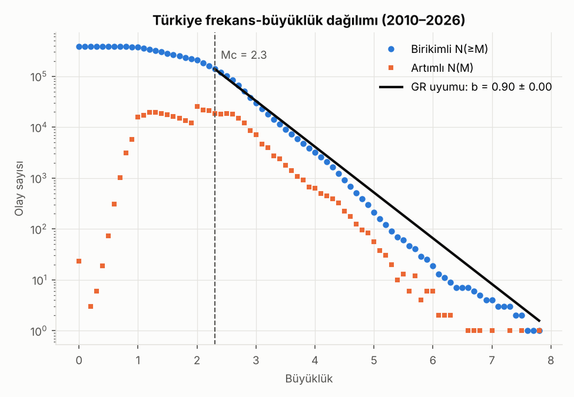
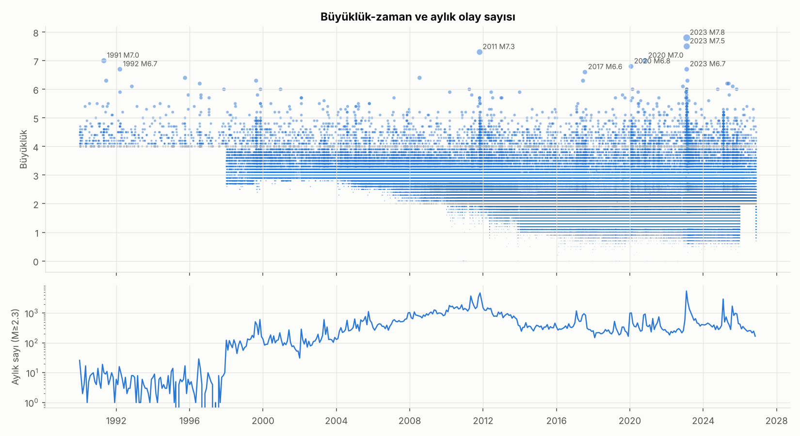
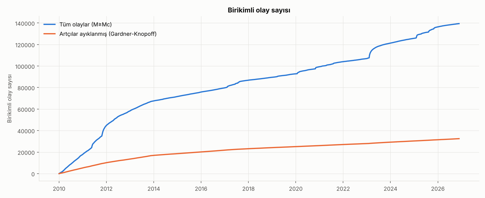
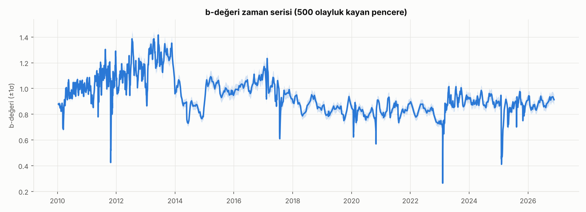
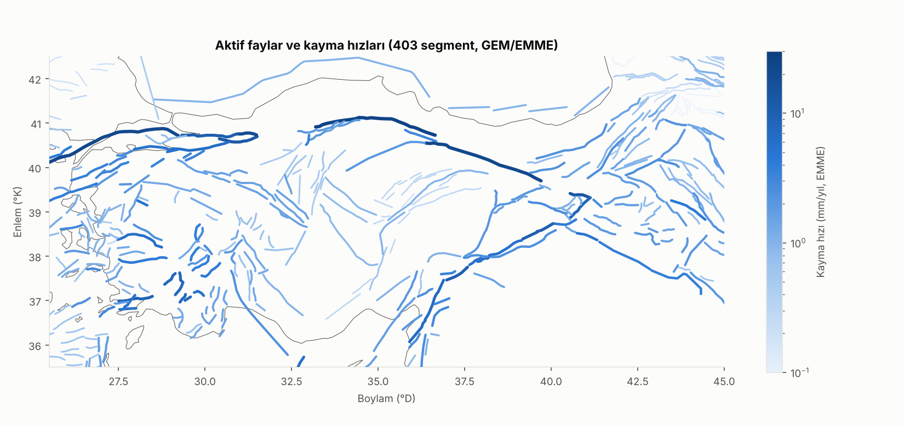
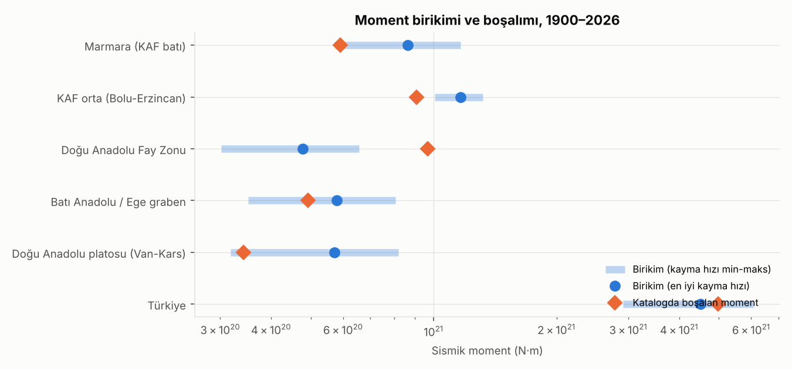
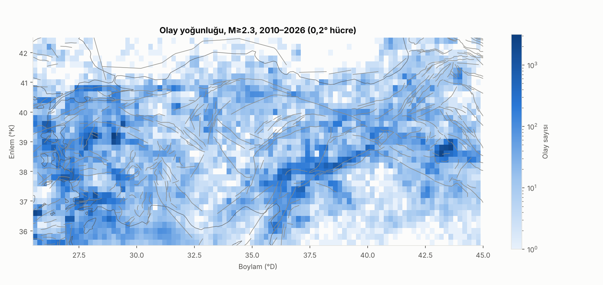
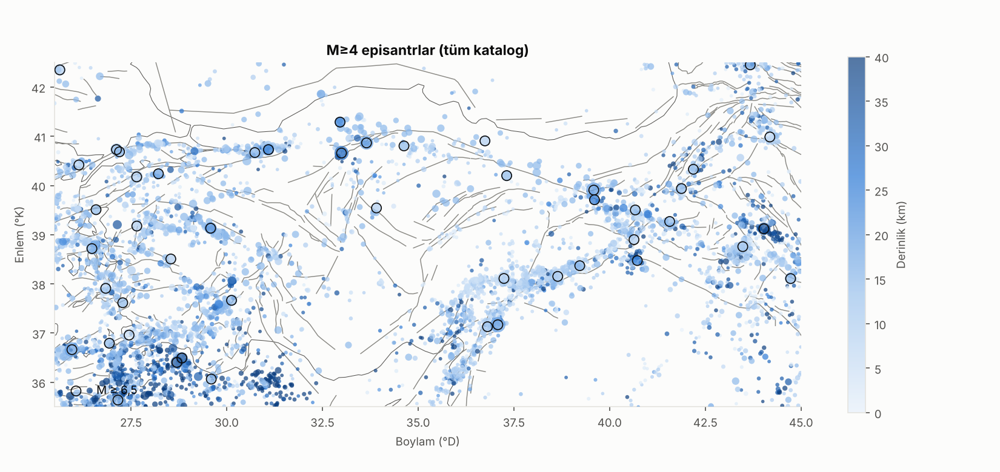
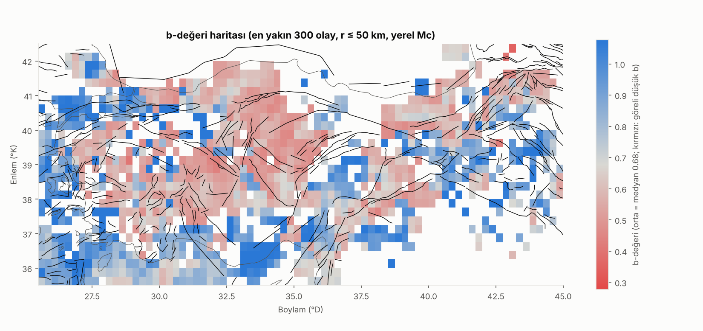

# Türkiye sismisite ve fay moment bütçesi: ilk prototip çıktıları

> **Uyarı.** Bu rapordaki hiçbir sayı bir deprem tahmini değildir. Hepsi betimsel istatistik veya ileride ileriye dönük olarak sınanacak hipotez değişkenleridir.

Üretim zamanı: 2026-11-24 19:57 UTC. Katalog bitişi: 2026-11-24.

## 1. Katalog

* Birleşik olay sayısı: **439,471** (afad: 261,600, emsc: 175,587, usgs: 2,284; tekilleştirme sonrası tutulan kaydın kaynağı)
* Zaman aralığı: 1904-08-11 – 2026-11-23
* Birden fazla kaynakta eşleşen olay: 48,945
* Mw bilgisi olan olay: 3,417

## 2. Gutenberg-Richter

Dönem 2010–2026 (16.9 yıl), Türkiye kutusu.

* Mc (maks. eğrilik +0,2): 2.2; Mc (iyi-uyum, R=91%): 2.3; kullanılan: **2.3**
* b = **0.899** ± 0.002 (Shi-Bolt), önyükleme σ = 0.002, N(M≥Mc) = 139,426
* Yıllık a-değeri = 5.99. GR ekstrapolasyonuyla yılda M≥5: 30.8, M≥6: 3.88, M≥7: 0.489 (artçılar dahil, betimsel)

Alt bölgeler:

| bölge                           |      n |   Mc |     b |   σ_b |   yıllık_M≥5_GR |
|:--------------------------------|-------:|-----:|------:|------:|----------------:|
| Marmara (KAF batı)              |  12042 |  2.3 | 1.009 | 0.013 |            0.6  |
| KAF orta (Bolu-Erzincan)        |  17576 |  2.4 | 1.092 | 0.015 |            0.4  |
| Doğu Anadolu Fay Zonu           | 100262 |  2   | 0.762 | 0.003 |           12.92 |
| Batı Anadolu / Ege graben       | 140031 |  2.4 | 1.088 | 0.005 |            3.61 |
| Doğu Anadolu platosu (Van-Kars) |  40127 |  2.6 | 1.066 | 0.01  |            2.08 |

Not: Doğu Anadolu Fay Zonu'ndaki düşük b büyük ölçüde 2023 Kahramanmaraş dizisinden gelir; büyük bir ana şoktan hemen sonra küçük artçılar kaydedilemez (kısa süreli tamlık kaybı), bu da b'yi yapay olarak düşürür. AFAD verisi ISC üzerinden ~2025 sonuna kadar gelir; 2026 için yalnızca EMSC ve AFAD'ın son iki haftası vardır, bu yüzden 2026 küçük olay sayıları eksiktir.

## 3. Zaman içinde sismisite

* Gardner-Knopoff ayıklaması sonrası bağımsız olay oranı (M≥Mc): 23%
* b(t) aralığı: 0.26 – 1.42. Kısa süreli düşüşler çoğunlukla büyük deprem dizilerine (ör. 2011 Van, 2020 Elazığ/Sisam, 2023 Kahramanmaraş) ve ağ değişimlerine denk gelir; tek başına öncül kabul edilmemeli.

## 4. Faylar ve moment bütçesi

GEM Küresel Aktif Fay veritabanından (EMME modeli) Türkiye kutusuna değen 403 segment. Her segment için M0̇ = μ·A·v (μ = 30 GPa, A = uzunluk × sismojenik genişlik, v = kayma hızı).

Zon başına 1900–2026 birikimi ile katalogdaki M≥5 olayların momenti (bağlaşım = 1 varsayımı):

| zone                            |   n_faults |   m0_accumulated |   m0_released |   release_ratio |   largest_event_mw |   largest_event_year |
|:--------------------------------|-----------:|-----------------:|--------------:|----------------:|-------------------:|---------------------:|
| Marmara (KAF batı)              |         13 |         8.65e+20 |      5.91e+20 |            0.68 |               7.6  |                 1999 |
| KAF orta (Bolu-Erzincan)        |         19 |         1.16e+21 |      9.09e+20 |            0.78 |               7.6  |                 1944 |
| Doğu Anadolu Fay Zonu           |         28 |         4.78e+20 |      9.68e+20 |            2.02 |               7.8  |                 2023 |
| Batı Anadolu / Ege graben       |         86 |         5.79e+20 |      4.92e+20 |            0.85 |               7.23 |                 1970 |
| Doğu Anadolu platosu (Van-Kars) |         81 |         5.71e+20 |      3.42e+20 |            0.6  |               7.3  |                 1976 |
| Türkiye                         |        384 |         4.5e+21  |      4.98e+21 |            1.11 |               7.8  |                 1939 |

**Okuma notu.** `release_ratio` 1'den küçükse zon katalog süresince biriktirdiğinden az moment boşaltmış görünür; bu bir 'gecikmiş deprem' kanıtı değildir. 1900 öncesi depremler (ör. 1509, 1766, 1894 Marmara; 1822, 1872 Doğu Anadolu) bilinmez, kayma hızları 2–4 kat belirsizdir ve aseismik krip (ör. İsmetpaşa) bağlaşımı düşürür.

Katalog içi biriken momenti en yüksek 15 segment (son M≥6'dan veya 1900'den bu yana; segment düzeyinde atama kabadır):

| fault_id   | slip_type       |   length_km |   slip_rate_mm_yr | last_big_event   |   years_since_ref |   mw_equiv_since_ref |
|:-----------|:----------------|------------:|------------------:|:-----------------|------------------:|---------------------:|
| ME_TRCS006 | Dextral         |         301 |              25   | 1953-09-07       |                73 |                 7.6  |
| ME_TRCS996 | Dextral-Normal  |         275 |              21.9 | 1975-03-27       |                52 |                 7.45 |
| ME_TRCS003 | Dextral         |         301 |              22.4 | 1992-03-13       |                35 |                 7.28 |
| ME_TRCS407 | Reverse         |         724 |               1   | katalogda yok    |               127 |                 7.17 |
| ME_TRCS129 | Reverse         |         161 |               3.7 | katalogda yok    |               127 |                 7.12 |
| ME_TRCS390 | Reverse         |         261 |               2.3 | katalogda yok    |               127 |                 7.11 |
| ME_GRCS699 | Dextral-Reverse |         178 |               6   | katalogda yok    |               127 |                 7.11 |
| ME_TRCS130 | Reverse         |         145 |               3.7 | katalogda yok    |               127 |                 7.06 |
| ME_TRCS133 | Reverse         |         186 |               2.5 | 1905-12-04       |               121 |                 7.04 |
| ME_TRCS023 | Dextral         |          97 |               5.3 | katalogda yok    |               127 |                 6.96 |
| ME_TRCS322 | Normal          |         126 |               5.7 | 1928-03-31       |                99 |                 6.95 |
| ME_TRCS331 | Normal          |         123 |               4.3 | katalogda yok    |               127 |                 6.93 |
| ME_TRCS033 | Dextral-Normal  |         132 |               3.9 | 1944-10-06       |                82 |                 6.86 |
| ME_TRCS027 | Dextral         |          98 |               3.6 | katalogda yok    |               127 |                 6.86 |
| ME_TRCS120 | Sinistral       |         202 |               2.3 | 1939-12-26       |                87 |                 6.86 |

## 5. Mekânda sismisite

Not: b haritası artçı ayıklanmamış katalogla yapıldı; ayıklama küçük olayları orantısız çıkardığı için b'yi yapay olarak düşürüyor. Bazı yüksek-b kümeleri taş ocağı/maden patlamalarından kaynaklanıyor olabilir (EMSC kataloğunda olay türü yok; AFAD/ISC verisi patlamaları ayrı işaretliyor ve onları zaten dışarıda bırakıyoruz).

Düşük b-değerli bölgeler bazı çalışmalarda yüksek diferansiyel gerilmeyle ilişkilendirilmiştir (Schorlemmer vd. 2005). Bu bir hipotezdir; harita bu hipotezi sınamak için girdi olarak tutulur.

## 6. Referans modeller ve test altyapısı

Eğitim 2010–2020, sınama 2020–2025, M≥4, 0,5° hücre. Bu iki model ileride ETAS ve fay/özellik tabanlı modellerin geçmesi gereken asgari çıtadır.

| model               |   N_beklenen |   N_gözlenen |   N_testi_q |    logL |   L_testi_γ |
|:--------------------|-------------:|-------------:|------------:|--------:|------------:|
| uniform_poisson     |        615.8 |         1434 |           0 | -3795.2 |           0 |
| smoothed_seismicity |        615.8 |         1434 |           0 | -3731.4 |           0 |

Düzleştirilmiş sismisitenin düzgün modele göre olay başına bilgi kazancı: **0.04** nat (p = 0.14). Her iki model de zamanda sabit olduğundan 2023 Kahramanmaraş dizisini (kümelenme) yakalayamaz; N-testindeki düşük q bu yüzdendir ve ETAS'ın neden gerekli olduğunu gösterir.

## 7. Fay kabuk elemanları

403 segment 1 km × 1 km elemanlara bölündü (Marmara'da 0,5 km): **546,992 eleman**, toplam fay alanı 464,288 km². Her elemanın parametre satırı `data/processed/fault_elements.csv.gz` dosyasında. Sismisite parametreleri elemana 5 km (3B) içindeki olaylardan, katalog sonuna kadar hesaplandı.

Kayıtlı 51 parametre (henüz verisi olmayanlar boş alan olarak tanımlı):

| name                      | unit      | status      | dolu_oran   | description                                                                |
|:--------------------------|:----------|:------------|:------------|:---------------------------------------------------------------------------|
| lon                       | °         | geometry    | 100%        | Eleman merkezi boylamı                                                     |
| lat                       | °         | geometry    | 100%        | Eleman merkezi enlemi                                                      |
| depth_km                  | km        | geometry    | 100%        | Eleman merkezi derinliği                                                   |
| strike                    | °         | geometry    | 100%        | Yerel doğrultu (kuzeyden saat yönü)                                        |
| dip                       | °         | geometry    | 100%        | Eğim                                                                       |
| area_km2                  | km²       | geometry    | 100%        | Eleman alanı                                                               |
| along_km                  | km        | geometry    | 100%        | Segment başından doğrultu boyunca uzaklık                                  |
| along_frac                | -         | geometry    | 100%        | Segment boyunca göreli konum (0-1)                                         |
| end_dist_km               | km        | geometry    | 100%        | En yakın segment ucuna uzaklık (kırılma durma/başlama bölgeleri)           |
| down_dip_km               | km        | geometry    | 100%        | Fay düzleminde üst kenardan aşağı uzaklık                                  |
| depth_rel                 | -         | geometry    | 100%        | Sismojenik zon içindeki göreli derinlik (0 üst, 1 alt)                     |
| strike_bend_deg           | °         | geometry    | 100%        | Komşu elemana göre doğrultu değişimi (bükülme/büklüm)                      |
| fault_len_km              | km        | geometry    | 100%        | Ait olduğu segmentin uzunluğu                                              |
| rake                      | °         | fault_db    | 100%        | Kayma açısı (mekanizma türü)                                               |
| slip_rate_mm_yr           | mm/yıl    | fault_db    | 100%        | Uzun dönem kayma hızı (en iyi tahmin)                                      |
| slip_rate_min             | mm/yıl    | fault_db    | 100%        | Kayma hızı alt sınırı                                                      |
| slip_rate_max             | mm/yıl    | fault_db    | 100%        | Kayma hızı üst sınırı                                                      |
| upper_depth_km            | km        | fault_db    | 100%        | Sismojenik zon üst sınırı                                                  |
| lower_depth_km            | km        | fault_db    | 100%        | Sismojenik zon alt sınırı (kilitli derinlik)                               |
| m0_rate_Nm_yr             | N·m/yıl   | fault_db    | 100%        | Moment birikim hızı = μ·A·v                                                |
| seis_n_all                | -         | seismicity  | 100%        | Elemana R km içindeki tüm olaylar (referans zamandan önce)                 |
| seis_n_10y                | -         | seismicity  | 100%        | Son 10 yıldaki olay sayısı (M≥Mc)                                          |
| seis_n_1y                 | -         | seismicity  | 100%        | Son 1 yıldaki olay sayısı (M≥Mc)                                           |
| seis_rate_z               | -         | seismicity  | 29%         | Hız değişimi z-değeri: son 1 yıl vs önceki 9 yıl (+ hızlanma, − sessizlik) |
| seis_b_10y                | -         | seismicity  | 1%          | Son 10 yıl b-değeri (Aki-Utsu; n<30 ise boş)                               |
| seis_max_mag              | -         | seismicity  | 66%         | Görülen en büyük büyüklük                                                  |
| seis_yrs_since_m4         | yıl       | seismicity  | 12%         | Son M≥4'ten bu yana geçen süre                                             |
| seis_yrs_since_m5         | yıl       | seismicity  | 2%          | Son M≥5'ten bu yana geçen süre                                             |
| seis_log_m0_10y           | log10 N·m | seismicity  | 49%         | Son 10 yılda boşalan sismik moment                                         |
| seis_mean_depth           | km        | seismicity  | 66%         | Yakın olayların ortalama derinliği                                         |
| seis_depth_std            | km        | seismicity  | 53%         | Yakın olayların derinlik yayılımı                                          |
| seis_frac_dependent       | -         | seismicity  | 66%         | Artçı/öncü (bağımlı) olay oranı: kümelenme/sürü göstergesi                 |
| seis_m0_release_ratio_10y | -         | seismicity  | 100%        | Son 10 yılda boşalan / biriken moment                                      |
| gnss_strain_rate          | 1/yıl     | placeholder | 0%          | GNSS'ten ikinci değişmez gerinim hızı                                      |
| gnss_slip_deficit_mm_yr   | mm/yıl    | placeholder | 0%          | Blok modelinden kilitlenme × kayma açığı                                   |
| locking_ratio             | -         | placeholder | 0%          | Jeodezik kilitlenme oranı (0 krip, 1 tam kilitli)                          |
| creep_rate_mm_yr          | mm/yıl    | placeholder | 0%          | Gözlenen aseismik krip hızı                                                |
| insar_los_rate_mm_yr      | mm/yıl    | placeholder | 0%          | InSAR görüş doğrultusu hız alanı                                           |
| heat_flow_mw_m2           | mW/m²     | placeholder | 0%          | Yüzey ısı akısı                                                            |
| curie_depth_km            | km        | placeholder | 0%          | Curie nokta derinliği (termal yapı)                                        |
| crustal_thickness_km      | km        | placeholder | 0%          | Kabuk kalınlığı (Moho)                                                     |
| vp_vs_ratio               | -         | placeholder | 0%          | Vp/Vs oranı (akışkan/doygunluk göstergesi)                                 |
| lithology_class           | kategori  | placeholder | 0%          | Fay boyunca kayaç türü                                                     |
| geothermal_proximity_km   | km        | placeholder | 0%          | En yakın jeotermal alana uzaklık                                           |
| friction_a_minus_b        | -         | placeholder | 0%          | Hız-durum sürtünme (a−b) tahmini (litolojiye dayalı)                       |
| tidal_stress_sensitivity  | -         | placeholder | 0%          | Gelgit gerilmesi fazı ile olay zamanlaması korelasyonu                     |
| coulomb_dcff_bar          | bar       | placeholder | 0%          | Geçmiş depremlerden birikimli Coulomb gerilme değişimi                     |
| coulomb_dcff_last_bar     | bar       | placeholder | 0%          | Son büyük depremden kaynaklı ΔCFF                                          |
| last_rupture_year         | yıl       | placeholder | 0%          | Elemanın bilinen son yüzey kırığı yılı (tarihsel dahil)                    |
| paleo_recurrence_yr       | yıl       | placeholder | 0%          | Paleosismolojik yinelenme aralığı                                          |
| fluid_pressure_index      | -         | placeholder | 0%          | Akışkan basıncı göstergesi (b, Vp/Vs, jeotermalden birleşik)               |

## 8. Öğrenme için özellik tablosu

`data/processed/feature_table.csv.gz`: 546 hücre × 16 yıl = 8,736 satır, 21 özellik (n_mc_1y, n_mc_5y, n_mc_10y, n_mc_30y, n_m5_all, log_m0_5y, log_m0_30y, max_mag_all, yrs_since_m4, yrs_since_m5, yrs_since_m6, b_10y, fault_dist_km, fault_log_m0_rate, fault_max_slip_mm_yr, fault_n, rate_z_1y, depth_mean_10y, depth_p90_10y, frac_dependent_10y, aftershocks_per_m4_10y).

Pozitif (en az bir olay olan) hücre-yıl sayısı: M≥3: 3,943, M≥4: 988, M≥5: 127, M≥6: 18.

Özellikler yalnızca pencere başlangıcından önceki veriden hesaplanır. Yeni değişkenler `deprem/features/table.py` içindeki `FEATURES` listesine eklenir.
