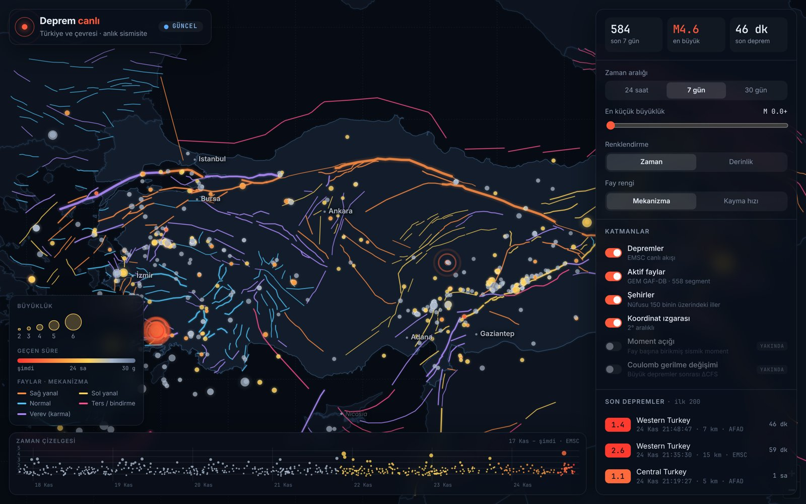

# Canlı deprem haritası (`web/`)

Türkiye ve çevresindeki depremleri anlık gösteren, derleme adımı gerektirmeyen statik bir site.



## Neler var

- **Canlı akış:** EMSC WebSocket (`standing_order`) üzerinden yeni depremler saniyeler içinde düşer;
  bağlantı koparsa kendini yeniden bağlar. Ek olarak her 60 sn'de EMSC FDSN yoklaması yapılır.
  EMSC'ye ulaşılamazsa USGS FDSN'e geçer. EMSC kataloğu AFAD ve KOERI çözümlerini de içerir.
- **Depremler:** büyüklüğe göre boyut, geçen süre veya derinliğe göre renk, son 3 saattekiler için dalga animasyonu,
  yeni deprem bildirimi, ayrıntı penceresi, zaman–büyüklük çizelgesi, 24 sa / 7 g / 30 g ve en küçük büyüklük filtresi.
- **Aktif faylar:** GEM Global Active Faults veritabanından bölgedeki 558 segment;
  mekanizmaya (sağ/sol yanal, normal, ters, verev) ya da kayma hızına (mm/yıl) göre renk, kayma hızına göre kalınlık.
- **Taban harita:** Natural Earth sınırları yerel GeoJSON olarak gömülü; harici karo sunucusu veya API anahtarı gerekmez.
- Mobil uyumlu (alttan açılan panel).

> Bu harita **tahmin yapmaz**; yalnızca kaydedilmiş depremleri ve bilinen fayları gösterir.

## Yerelde çalıştırma

```bash
cd web
python3 -m http.server 8000
# http://localhost:8000
```

(ES modülleri `file://` ile açılmaz; bir yerel sunucu gerekir.)

## Yayınlama (GitHub Pages)

`.github/workflows/pages-web.yml`, `main` dalına `web/` altında bir değişiklik geldiğinde siteyi yayınlar.
Bir kez: depo **Settings → Pages → Build and deployment → Source: GitHub Actions** seçilmeli.

## Dosyalar

| Dosya | İçerik |
|---|---|
| `index.html`, `css/style.css` | Arayüz |
| `js/feeds.js` | EMSC/USGS veri çekme ve canlı WebSocket, ortak olay biçimi |
| `js/layers.js` | Harita stili, renk ölçekleri ve temel katmanlar (`OVERLAYS`) |
| `js/app.js` | Durum, çizim, panel, zaman çizelgesi, bildirimler |
| `js/custom-layers.js` | `data/layers/*.layer.json` tanımlarından bilimsel veri katmanları |
| `data/*.geojson` | Faylar, ülke sınırları, şehirler (`tools/build_data.py` ile üretilir) |

Verileri yeniden üretmek için:

```bash
curl -LO https://raw.githubusercontent.com/GEMScienceTools/gem-global-active-faults/master/geojson/gem_active_faults_harmonized.geojson
curl -LO https://raw.githubusercontent.com/nvkelso/natural-earth-vector/master/geojson/ne_10m_admin_0_countries.geojson
curl -LO https://raw.githubusercontent.com/nvkelso/natural-earth-vector/master/geojson/ne_10m_populated_places_simple.geojson
python3 web/tools/build_data.py gem_active_faults_harmonized.geojson ne_10m_admin_0_countries.geojson ne_10m_populated_places_simple.geojson
```

## Veri katmanı ekleme

Modelden çıkan her katman (Coulomb gerilme, ETAS oranları, gaz/radon istasyonları, ısı akısı, jeotermal sahalar…)
kod değiştirmeden haritaya eklenir. Her katman için iki dosya yeterlidir:

```
web/data/layers/<id>.layer.json   # tanım: ad, grup, renk ölçeği, lejant, açıklama penceresi
web/data/layers/<id>.geojson      # veri (GeoJSON FeatureCollection, WGS84)
```

`web/data/layers/index.json` yayın sırasında `web/tools/build_layer_index.py` ile otomatik üretilir (depoya girmez).
Yerelde denemek için betiği bir kez çalıştırın. Panelde katmanlar `group` başlıkları altında listelenir;
açılan her katman lejantta ve üzerine gelince açılan pencerede görünür.

### Tanım dosyası

```jsonc
{
  "id": "coulomb_1999",                 // isteğe bağlı; yoksa dosya adı
  "label": "Coulomb ΔCFS · 1999 İzmit", // paneldeki ad
  "description": "Fay elemanları üzerinde", // panelde altta küçük yazı
  "group": "Gerilme ve ETAS",           // panel başlığı (aynı gruptakiler birlikte)
  "order": 20,                          // küçük olan önce (varsayılan 100)
  "data": "coulomb_1999.geojson",       // bu klasöre göre; "data/..." ile başlarsa site köküne göre; ya da tam URL
  "visible": false,                     // açılışta görünsün mü
  "updated": "2026-11-24",
  "note": "Tahmin değildir.",           // lejantta ve pencerede; yoksa GeoJSON metadata.note kullanılır

  "style": {
    "type": "auto",       // auto | fill | line | circle | heatmap  (auto: geometriden; nokta→daire, çizgi, poligon→dolgu)
    "opacity": 0.5,
    "width": 2.4,         // çizgi kalınlığı (px)
    "radius": 5,          // nokta yarıçapı (px); heatmap'te yayılma yarıçapı
    "glow": true,         // çizgilerde hafif parıltı
    "outline": "#ffffff", // nokta/poligon kenar rengi
    "intensity": 2        // yalnızca heatmap
  },

  "color": {
    "property": "dcfs_bar",            // ya da ["mw_equiv", "mw_equiv_since_ref"]: ilk dolu olan
    "type": "interpolate",             // interpolate (sürekli) | step (sınıflı) | categorical | fixed
    "stops": [[-1, "#3f7be0"], [0, "#1b2433"], [1, "#ff3b30"]],   // interpolate / step
    "categories": { "aktif": "#35e08a", "pasif": "#8796ab" },     // categorical
    "default": "#8aa0bb",              // categorical'da listede olmayan değer
    "missing": "#3a4659",              // alan boşsa
    "value": "#ffd25a"                 // fixed
  },

  "size": { "property": "debi", "stops": [[0, 3], [100, 12]] },   // nokta yarıçapı / çizgi kalınlığı (isteğe bağlı)

  "legend": {
    "title": "ΔCFS", "unit": "bar",
    "labels": ["-1", "0", "+1"],                    // ölçeğin altındaki etiketler (yoksa durak değerlerinden)
    "categoryLabels": { "aktif": "Aktif", "pasif": "Pasif" }
  },

  "tooltip": {                                       // false: pencere yok; alan yoksa ilk 8 özellik
    "title": "name",
    "fields": [{ "property": "dcfs_bar", "label": "ΔCFS", "unit": "bar", "digits": 2 }]
  }
}
```

Notlar:

- Sayısal alanları sayı olarak yazın. 1e15 ve üstü değerler (ör. N·m) metin de olabilir; harita ikisini de sayı olarak okur.
  (MapLibre bu büyüklükteki sayılarla katmanı çizemediği için yükleyici bunları zaten metne çevirir.)
- Dosya başına ~5 MB'ı geçmeyin: koordinatları 4 ondalığa yuvarlayın, çok sayıda küçük elemanı segment ya da hücre düzeyine özetleyin.
- Bozuk bir tanım ya da eksik veri dosyası yalnızca o katmanı etkiler; panelde "veri yok" olarak görünür.
- Örnek: `data/layers/moment_deficit.layer.json` (çizgi, sürekli renk ölçeği, alan yedeği, özel pencere alanları).

## Kaynaklar ve lisanslar

- Depremler: [EMSC](https://www.seismicportal.eu) (FDSN + WebSocket), yedek [USGS](https://earthquake.usgs.gov/fdsnws/event/1/)
- Faylar: [GEM Global Active Faults](https://github.com/GEMScienceTools/gem-global-active-faults), CC BY-SA 4.0
- Sınırlar ve şehirler: [Natural Earth](https://www.naturalearthdata.com), kamu malı
- Harita motoru: [MapLibre GL JS](https://maplibre.org) 4.7.1 (BSD-3)
